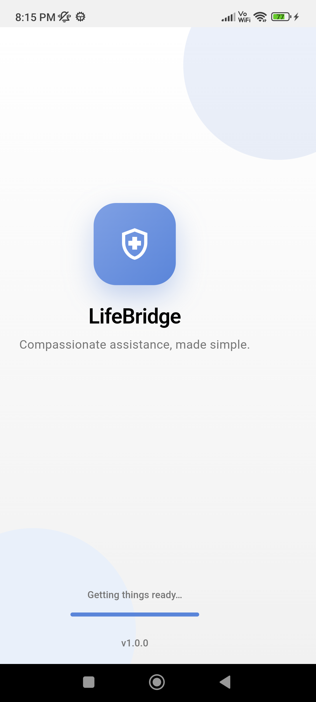
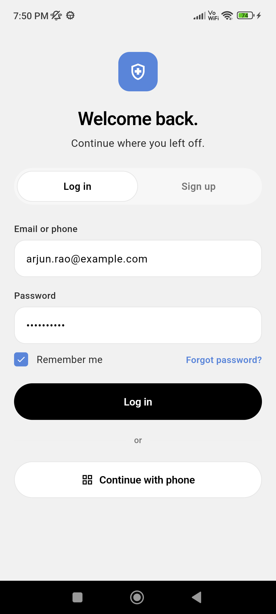
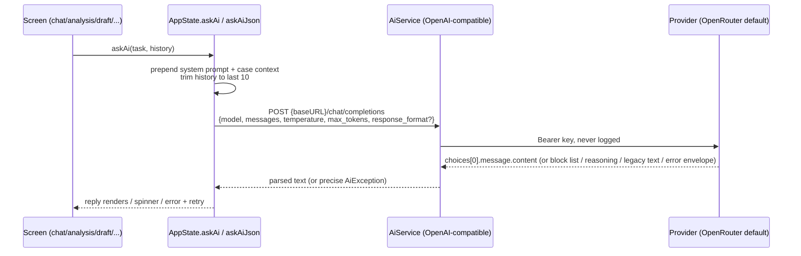
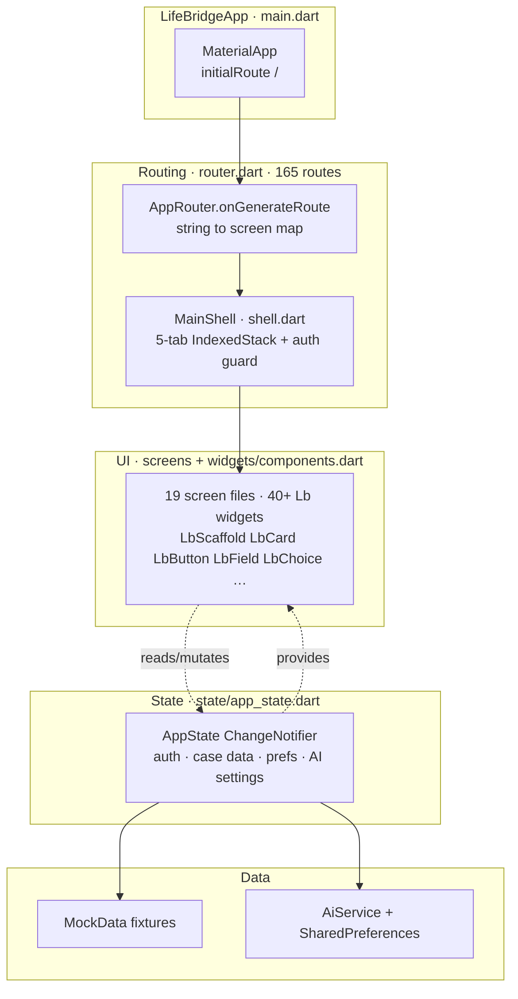
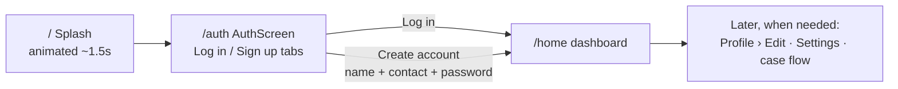

# LifeBridge 🌉

> **Compassionate assistance, made simple.** A Flutter patient-assistance case-management app that helps patients and caregivers discover financial, medical, and community support programs — with a real AI backend wired into every assistant surface.

    

---

## 📱 Screens

| Launch (animated splash) | Unified auth (Log in / Sign up) |
|---|---|
|  |  |

*Screenshots captured from a real device (Redmi Note 10S, Android 13); demo data shown.*

---

## ✨ What the app does — end to end

```
Open app → Splash → Auth (login/signup, 2 fields) → Home dashboard (5 tabs)
                                                              │
                    ┌─────────────┬──────────────┬────────────┼─────────────┐
                    ▼             ▼              ▼            ▼             ▼
                  Home          Cases          Docs       Follow-up      Profile
              (case hero,    (detail,      (center,      (draft with   (view/edit,
               gap, apps,     timeline,     upload,       AI drafts,     settings,
               matches)       edit)         camera,       reminders)     AI setup)
                                                AI extract)
```

**Core user journeys**

1. **Case management** — create a case step-by-step (type → patient → treatment → hospital → finance → insurance → documents → review → consent), track the funding gap, timeline, and matched programs.
2. **Support discovery** — browse programs, check eligibility, see why each matches, and prepare applications.
3. **Applications** — AI-drafted personal statements, document checklists, consent, submit tracking, receipts, approvals/rejections.
4. **Documents** — upload center, camera capture, AI field extraction + review, missing-doc nudges.
5. **Follow-ups** — AI-drafted reminder emails (regenerate / shorter / more formal), confirm + send flow, history, reassessment.
6. **AI assistant** — multi-turn chat grounded in the live case, thinking → answer → suggested-action chain, case analysis with structured results (needs, doc plan, next steps).
7. **Profile & settings** — edit profile, notification/privacy/security preferences, emergency hub, and the AI backend configuration (below).

---

## 🧠 Real AI integration (not mocks)

Every AI-claiming surface calls a live model. There are **no static fallback answers** — failures surface honest errors with retry.



**How it works technically**

| Piece | Detail |
|---|---|
| Client | `lib/services/ai_service.dart` — `POST {baseURL}/chat/completions`, Bearer auth, OpenAI-compatible (OpenAI, OpenRouter, Together, local gateways) |
| Settings | `AppState` (`lib/state/app_state.dart`): `aiBaseUrl`, `aiApiKey`, `aiModel` — read **at call time**, so model switches apply to the very next request; persisted on-device via `SharedPreferences`, loaded at startup |
| Defaults | Built-in OpenRouter base URL + free model (`openrouter/free`); the user enters a personal API key once in Settings (no key is bundled — secret scanners rightly reject hardcoded keys) |
| Model picker | `GET {baseURL}/models` → selectable list in Profile › Settings › AI assistant (`/settings/ai`); manual entry kept as fallback for providers without `/models` |
| Grounding | Every request carries a system prompt with a live case summary (patient, treatment, gap, income, programs, documents) + an **app-scope rule**: answer only LifeBridge-related topics, politely decline the rest |
| Structured output | Analysis/extraction use JSON mode (with automatic fallback if a provider rejects the flag), low temperature, generous budgets, tolerant parsing (fences/prose), plus **one genuine repair retry** before erroring |
| Long chats | Sliding window (last 10 messages sent; UI keeps full history) + a **New chat** reset; context-overflow (400) is detected and explained |
| Reply shapes | Accepts string content, content-block lists, `reasoning_content`, legacy `.text`, gateway envelopes; 200-status error envelopes surface the provider's real message; unparseable bodies quote a preview |
| Errors | Mapped to plain language: no network, timeout, 401 bad key, 404 bad endpoint/model, 429 rate-limit (with free-tier guidance), 5xx; key never appears in messages, logs, or UI |
| Testability | Injectable `http.Client`; 39 tests cover bodies, flags, mappings, trimming, persistence, launch flow, and every screen's error path with zero real network calls |

> ℹ️ **Key note:** no API key is bundled with the app — each user enters a personal key once in Settings. Never commit a real key: GitHub push protection blocks it, and anything in git/APKs is extractable.

---

## 🏗️ Architecture



**Design rules the codebase follows**

- **One store**: a single `AppState` `ChangeNotifier` exposed via `AppScope` (`InheritedNotifier`). One-off reads use `AppScope.read(context)`; mutate only through its methods (each calls `notifyListeners()`).
- **Stringly-typed routing**: every screen is registered in `router.dart`'s `_routes` map; unknown names fall back to a *Route not found* page. Tab roots render `HomeShell(initial: n)`.
- **Design tokens only**: colors/radii/spacing come from `core/theme/theme.dart` (`LbColors`, `LbRadius`, `LbSpacing`) + the shared `Lb*` widget library — no per-screen styling reinvention.
- **No backend**: all domain data is in-memory `MockData` fixtures (edit `data/mock_data.dart` to change the demo); the only network calls are the AI APIs above.
- **Demo persona**: user **Saikumar** (`admin@saikumar.link`), caregiver for uncle **Ramakrishna**, based in **Bhimavaram, Andhra Pradesh** — all fixtures, strings, and the AI's case briefing reflect this.

---

## 🚀 Launch flow (simplified)



Cold start used to be **11 screens / ~15 fields** (welcome → 3× onboarding → role → user-type → 4-step registration → permissions → success). It is now **splash → one auth screen → home**. Deferred details (DOB, city, patient info, permissions) are collected later in Profile › Edit, Settings, or naturally during case creation. Old routes stay registered; entry points (splash, auth guard, sign-out, session-expired) all converge on `/auth` with clean back stacks.

---

## 📁 Project structure

```
lib/
├── main.dart                  # Entry: LifeBridgeApp (loads AI settings at startup)
├── router.dart                # 165 named routes + AppNavigator + HomeShell
├── shell.dart                 # MainShell: 5-tab IndexedStack + auth guard
├── core/theme/theme.dart      # LbColors / LbRadius / LbSpacing / buildLbTheme()
├── state/app_state.dart       # The single store: auth, case data, prefs, AI settings
├── data/mock_data.dart        # All demo fixtures (Bhimavaram persona)
├── models/models.dart         # Immutable data classes (User, Patient, CaseEntity, …)
├── services/ai_service.dart   # OpenAI-compatible client + JSON parsing + errors
├── widgets/components.dart   # 40+ shared Lb widgets
└── screens/                   # 19 files, one flow each (suffix = design frame range)
    ├── splash_01.dart         # Splash + Welcome + Onboarding ×3
    ├── get_started_06_07.dart # Role + user-type (off the launch path)
    ├── auth_08.dart           # Unified Log in / Sign up (the launch entry)
    ├── login_08.dart          # Login + phone + OTP + success
    ├── register_15_21.dart    # Legacy multi-step registration + forgot/reset
    ├── home_22_25.dart        # Dashboard + tab shells + case list
    ├── case_create_28_38.dart # Case wizard · case_created_39 · cases_40_48
    ├── ai_analysis_49_54.dart # Analysis → results/needs/docs/steps (live AI)
    ├── support_55_64.dart     # Program discovery + eligibility
    ├── documents_65_75.dart   # Docs center + upload + AI extraction
    ├── applications_76_99.dart# Full application lifecycle + AI draft
    ├── followups_100_118.dart # Follow-up drafts (live AI) + history
    ├── ai_assistant_119_128.dart # Assistant home + live multi-turn chat
    ├── notifications_129_134.dart
    ├── profile_135_147.dart   # Profile + all Settings incl. /settings/ai
    ├── emergency_148_154.dart
    └── states_155_165.dart    # System-state gallery screens
test/
├── ai_service_test.dart       # Client: parsing, flags, error mapping, /models
├── ai_integration_test.dart   # State, persistence, settings UI, chat errors
└── app_flow_test.dart         # Cold start + every AI screen's error path
docs/images/                   # Device screenshots used above
android/                       # INTERNET permission declared; Impeller opted out
                               # (blank frames on Mali GPUs — Skia fallback)
```

**Route groups** (see `router.dart` for the authoritative map — 165 total): auth/onboarding (21) · home (4) · case wizard + detail (20 + `/cases` root) · AI analysis/assistant (15) · support (9) · docs (11 + `/docs` root) · applications (24) · follow-ups (18 + `/followups` and `/find-alternative` roots) · notifications (5 + root) · profile/settings/help (15) · emergency (6 + root) · system states (11).

---

## 🛠️ Setup & run (fresh machine)

Prerequisites: **Java 17+**, **Android SDK** (platform-tools, build-tools, a platform), **unzip** on PATH, and a device with USB debugging (or an emulator).

```bash
# 1. Flutter SDK (if missing)
git clone https://github.com/flutter/flutter.git -b stable --depth 1 ~/flutter
export PATH="$HOME/flutter/bin:$PATH"

# 2. This project
cd lifebridge
export JAVA_HOME=<jdk-17> ANDROID_HOME=$HOME/Android/Sdk
flutter pub get

# 3. Verify
flutter analyze        # must report: No issues found!
flutter test           # 39 tests, all green

# 4. Run / install on a USB-attached phone
flutter devices                      # confirm the phone is listed
flutter build apk --debug
adb install -r build/app/outputs/flutter-apk/app-debug.apk

# 5. Shareable build
flutter build apk --release          # → build/app/outputs/flutter-apk/app-release.apk
```

> 📌 Gotchas learned the hard way on this machine: Flutter needs `unzip` (a `bsdunzip` shim works); Gradle needs JDK 17 (Android Studio's bundled JBR is fine); **release APKs need `INTERNET` declared** (debug gets it injected — already fixed in the manifest); Mali GPUs may need the Impeller opt-out already in the manifest.

---

## ⚙️ Configuration

| Where | What |
|---|---|
| Profile › Settings › **AI assistant** | Base URL (any OpenAI-compatible server), **Fetch available models** → tap to select, personal API key (required, stored on-device), Save |
| `AppState.defaultAiBaseUrl/Key/Model` | Compile-time fallbacks — change here to re-brand the defaults |
| `MockData` | Demo user/case/programs/documents |
| `AppState()` field defaults | `signedIn=false`, feature flags, quiet hours |

---

## ✅ Verification & device notes

- `flutter analyze` — clean (lint set: `flutter_lints`).
- `flutter test` — 39 tests; AI tests use mocked HTTP / dead endpoints, so the suite makes **zero real network calls**.
- Proven on-device via `adb`: screenshots above, `uiautomator` checks, and `logcat` diagnosis of a real white-screen incident (an `Expanded`-in-`Row` layout crash, since fixed, with regression coverage in the launch test).
- Release is debug-key signed (direct-install sharing, not Play Store).

## 🔒 Security notes

- API keys live in app-private `SharedPreferences`, travel only as `Authorization` headers to the configured base URL, and never appear in logs, errors, or UI.
- No key is bundled or committed — for stronger protection consider `flutter_secure_storage` for the saved key.

## 🗺️ Known limitations / next steps

- Domain data is in-memory mocks (no backend sync); secure storage (e.g. flutter_secure_storage) would harden the saved key.
- Long wizard chains build deep back stacks (`pushNamed` throughout) — candidates for replace/pop at irreversible steps.
- Several contact/call buttons are inert placeholders; program-detail screens always show the first program (needs an id argument).
- Deliberately deterministic (not live AI): the eligibility questionnaire and why-match explainer are rules/info UI with no AI-generation claims.
- ~26 registered routes are currently unreachable (legacy onboarding, variant home screens, state gallery) — kept for compatibility.
